# Data Centric Programming Assignment 2025

- [Assignment Brief](dataset_assignment.md)

# Questions
* During which days am I most and least productive?
* What relationship exists between studying and programming? Are they both proportional/inversely proportional to each other?
* Does sleep hours affect productivity?
* Does gaming affect sleep hours?

# Data Dictionary
The database contains 8 attributes, and 1 metadata attribute, which are as follows:
```
Date         | Qualitative Ordinal   | meta

Day          | Qualitative Nominal   | tracked  (via calendar)
Sleep        | Quantitative Discrete | measured (hrs)
Reading      | Quantitative Discrete | measured (min)
Gaming       | Quantitative Discrete | measured (min)
Studying     | Quantitative Discrete | measured (min)
Programming  | Quantitative Discrete | measured (min)
Misc Leisure | Quantitative Discrete | measured (min)

Productivity | Qualitative Ordinal   | produced (via classifier)
```
Productivity is measured by a simple tree classifier; provided below in LaTeX notation:



The classifier as shown above is implemented in Excel, and exported as a .csv

## First Three rows of the Dataset (Compact)
| Date | Day | Sleep (Hours) | Reading (Minutes) | ... | Misc Leisure (Minutes) | Productivity |
|-------|-----|--------------|-------------------|-----|-------------------------|-------------|
| 19/10/2026 | Monday | 9 | 30 | ... | 240 | MODERATE
| 20/10/2026 | Tuesday | 7 | 60 | ... | 320 | LOW
| 21/10/2026 | Wednesday | 9 | 90 | ... | 320 | MODERATE

The full .csv dataset available [here](dataset/productivity_metrics.csv) (incomplete).
# Description of the project
The project revolves around tracking my habits in a quantitative format, and producing a productivity score from it. The goal of the project is to answer some interesting [questions](#Questions) about my day-to-day life through data graphs, also create an interface to display the graphs, and allow users to query the database for their perusal.

I plan to use
- Python: as the programming language for the project infrastructure
- Pandas: for data manipulation
- Tkinter: for creating  the interface
- SQLite3: an SQL API to enable data querying

*List subject to change
# Instructions for use

# How it works:

# Findings

# List of files in the project

| Files | Source |
|-----------|-----------|
| main.py | Self written |
| test.py | Modified from [reference]() |
| test.py | From [reference]() |

# References
* Item 1
* Item 2

# What I am most proud of in the assignment

# What I learned