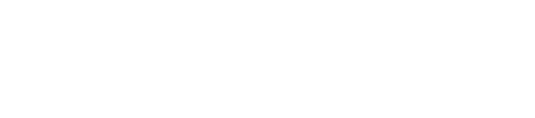
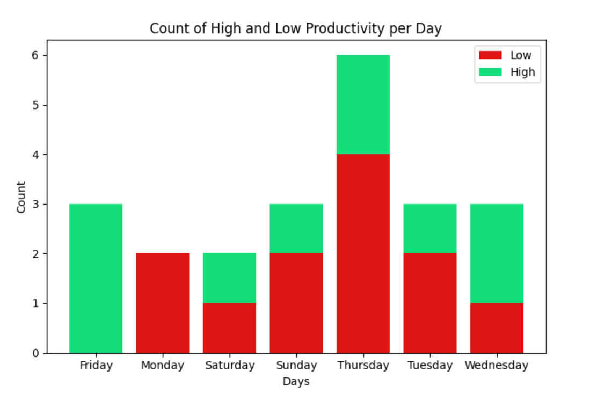
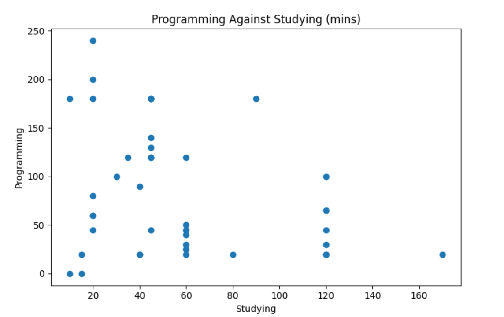
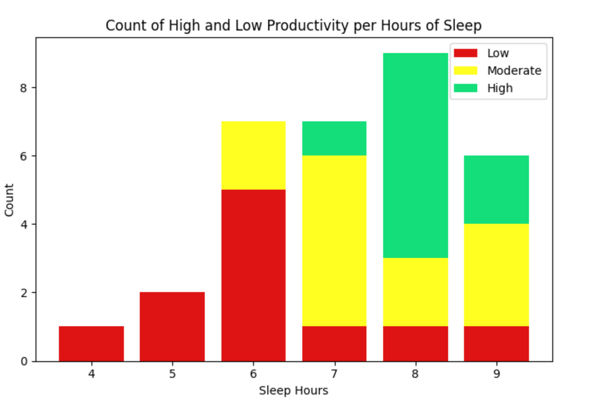
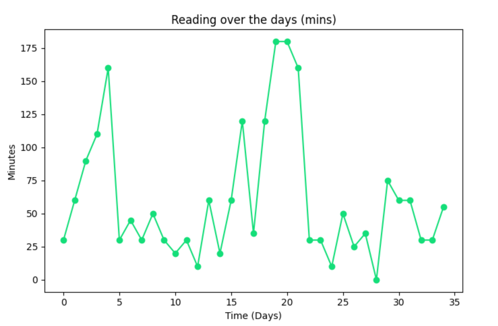
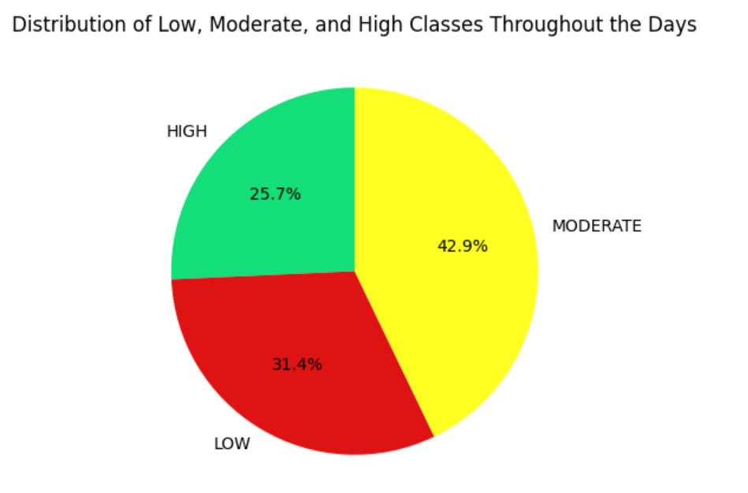

# Data Centric Programming Assignment 2025

- [Assignment Brief](dataset_assignment.md)

# Questions
* During which days am I most and least productive?
* What relationship exists between studying and programming? Are they both proportional/inversely proportional to each other?
* Does sleep hours affect productivity?
* What was the progression of reading books each day? Was it positive/negative/stagnant?
* What is the distribution of 'low', 'moderate', and 'high' productivity classes

# Data Dictionary
The database contains a table called *productivity_metrics*, which contains 9 attributes, which are as follows:
```
Date         | Qualitative Ordinal   | tracked  (via calendar)

Day          | Qualitative Nominal   | tracked  (via calendar)
Sleep        | Quantitative Discrete | measured (hrs)
Reading      | Quantitative Discrete | measured (min)
Gaming       | Quantitative Discrete | measured (min)
Studying     | Quantitative Discrete | measured (min)
Programming  | Quantitative Discrete | measured (min)
Misc Leisure | Quantitative Discrete | measured (min)

Productivity | Qualitative Ordinal   | produced (via classifier)
```
Productivity is measured by a simple tree classifier; provided below in LaTeX notation (view in dark mode):



The classifier as shown above is computed in Excel, and the Excel file is exported as a .csv

## First Three rows of the Dataset (Compact)
| Date | Day | Sleep (Hours) | Reading (Minutes) | ... | Misc Leisure (Minutes) | Productivity |
|-------|-----|--------------|-------------------|-----|-------------------------|-------------|
| 19/10/2026 | Monday | 9 | 30 | ... | 240 | MODERATE
| 20/10/2026 | Tuesday | 7 | 60 | ... | 320 | LOW
| 21/10/2026 | Wednesday | 9 | 90 | ... | 320 | MODERATE

The full .csv dataset available [here](dataset/productivity_metrics.csv).

# Description of the project
The project revolves around tracking my habits in a quantitative format, and producing a productivity score from it. The goal of the project is to answer some interesting [questions](#Questions) about my day-to-day life through data graphs, also create an interface to display the graphs, and allow users to query the database for their perusal.

I plan to use
- Python: as the programming language for the project infrastructure
- Pandas: for data manipulation
- Tkinter: for creating  the interface
- SQLite3: an SQL API to enable data querying

# Instructions for use
Run
```
> python main.py
```
To initiate a dashboard instance.

Shortcuts for speed of use are available in the 'Help' section of the dashboard.

# How it works:
### Contents
The program consists of 4 main pages, which are as follows:
- Data Graph: 5 graphs/charts that help answer the 5 [questions](#questions)
- Query: a way to enter read-only SQL queries, whose results are logged into the console
- Insertion: a way to enter insertion queries and insert rows into the table *productivity_metrics*
- Help: contains helpful shortcuts

There also is a *QUIT* button, which kills the program.

All these pages are contained in a window which is named *Dashboard*.

### Runtime Behaviour
- When a dashboard is initiated after running `main.py`, a connection to the database is established via *SQLite3*
- The connection is then borrowed to the three pages (Data Graph, Query, Insertion) that interact with the database in some way
- The 'borrowing' is done via a class which establishes the connection, stores it in an object, and lends itself to be inherited by classes that require it
- To load the appropriate data for each graph, I hardcoded specific SQL queries and stored them in a list of dictionaries also containing the graph's title, and x-y labels
- The queries are ran via pandas' read_sql() API and stored in a df object to be used as data
- To insert graphs as Tkinter objects, I used the Matplotlib backend *FigureCanvasTkAgg* which converts a Matplotlib figure to a Tkinter canvas
- To let the user run read-only and insertion queries, I grabbed the text from the *Entry* widget and put it into read_sql() and conn.cursor.execute() respectively
- Read-only queries and debug messages are logged to the console
# Findings
> During which days am I most and least productive?



The bar graph showed that Fridays are the days where I'm most productive, and Thursdays are the least.

> What relationship exists between studying and programming? Are they both proportional/inversely proportional to each other?



The two appear to be inversely proportional, as the more I study, the less I program, and vice versa.

> Does sleep hours affect productivity?



From the graph, I would say they do, as sleep hours <7 do not have many productive days.

> What was the progression of reading books each day? Was it positive/negative/stagnant?



There seems to be high spikes in days where I read a lot, but generally, it seems to be stagnant.

> What is the distribution of 'low', 'moderate', and 'high' productivity classes



As seen above, the majority of days I'm at a moderate productivity level, and I seem to be more likely to not be productive than to be highly productive.

# List of files in the project

| Files | Source | Description |
|-----------|-----------|-------|
| main.py | Self-written | Starts the program |
| synchronise.py | Self-written | Synchronises .csv with the database |
| application.py | Self-written | Contains the GUI code |
| config.py | Self-written | Contains the relative dimensions/positions for each GUI widget |


# References
* [Tkinter Reference](https://tkdocs.com/pyref/)
* [SQLite Reference](https://realpython.com/ref/stdlib/sqlite3/)
* [Python Reference](https://www.w3schools.com/python/python_reference.asp)
* [GUI Playlist](https://www.youtube.com/playlist?list=PLpMixYKO4EXeaGnqT_YWx7_mA77bz2VqM)


# What I am most proud of in the assignment
When creating the mechanism for handling database connections between pages, I independently discovered the concept of Mixins.

Mixins are classes whose only purpose is to be inherited by others, they encapsulate small, specialised pieces of code and resources that is shared amongst child classes.

In my case the shared resource was the database connection, I did not want to re-establish connection each time I opened a new page, which is why I created the *DBConnection* Mixin.


# What I learned
Though I learned a lot about software design in general, the three key things I learned that I thought were worth noting are:

* Code Encapsulation: I believe I encapsulated code well into separate files, functions, and classes alike
* Comfortability with Software: I feel more comfortable starting projects with the knowledge I know now
* Merging Technologies Together: My app's stack contained various technologies such as a database API (SQLite3), a GUI API (Tkinter), a plotter (Matplotlib), and a data science tool (pandas) which worked well in tandem